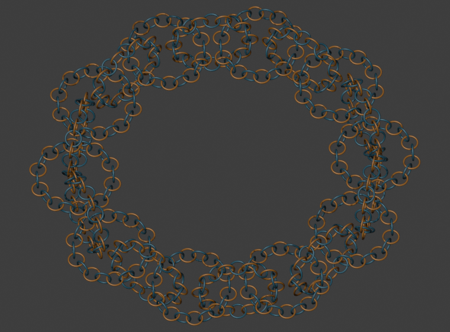
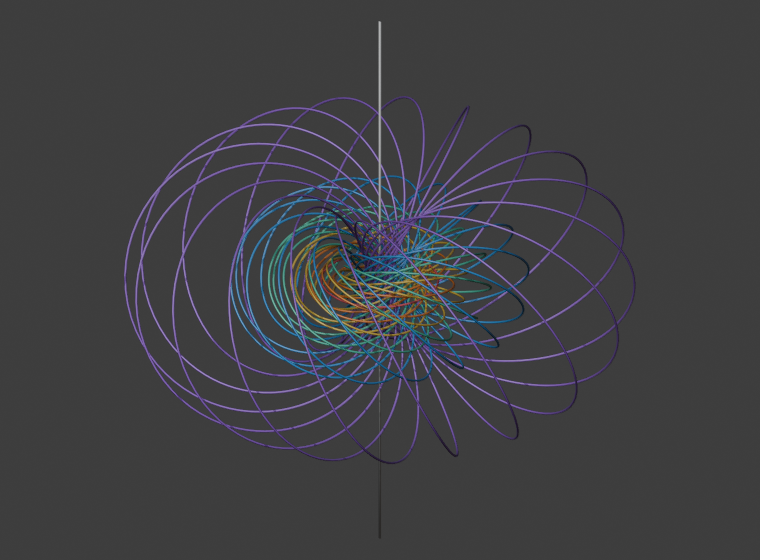

# Math Objects in Blender

A couple Blender Python scripts for making fun objects in topology/geometry like the Hopf fibration and Antoine's necklace. 

| Antoine's necklace | Hopf fibration |
| --- | --- |
|  |  |

| Script | What it makes | Settings to try |
| --- | --- | --- |
| [Antoine's necklace](antoines_necklace.py) | A finite stage of Antoine's necklace, built from linked rings of tori nested inside one another. | Set `DEPTH = 1` to see the basic chain, or change `MATERIAL_PATTERN` to recolor the links. |
| [Hopf fibration](hopf_fibration.py) | A sample of the Hopf fibration in stereographic projection. The circular fibers sit on nested tori, and the straight axis represents the fiber that passes through the projection point. | Change `FIBERS_PER_LAYER` for a sparser or denser view, or turn off `SHOW_AXIS` to hide the axis. |

## How to use

1. Download a script from the table and open a new Blender file.
2. Go to the **Scripting** workspace and open the **Text Editor**; click **Open** and select the downloaded `.py` file.
3. Click **Run Script** and the object will be generated at the center of the scene. 

Both scripts were tested in Blender 5.2.2 and use Blender's built-in Python modules. You can change the settings at the top of each file and run it again. Antoine's necklace replaces its own generated objects on rerun. The Hopf script adds a fresh collection each time, so delete the previous collection if you want a single copy.

The default necklace uses 20 links at depth 2. Try depth 1 while experimenting with the shape. At depth 3, the default link count describes 160,000 tori, so keep grouping enabled if you try it.

If you make a variation or have another mathematical object in mind, feel free to open an issue or a pull request.
